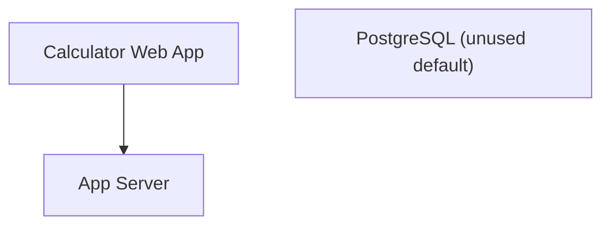
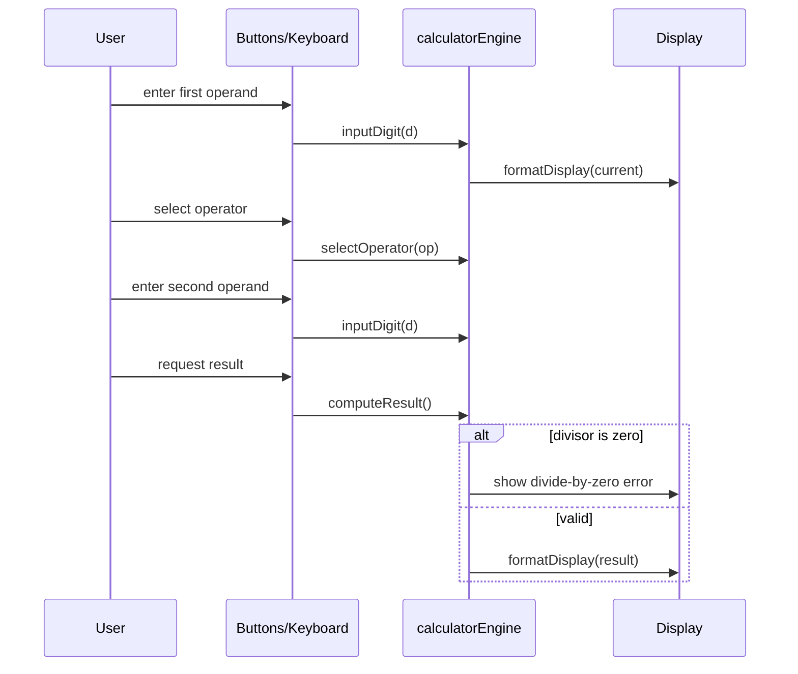
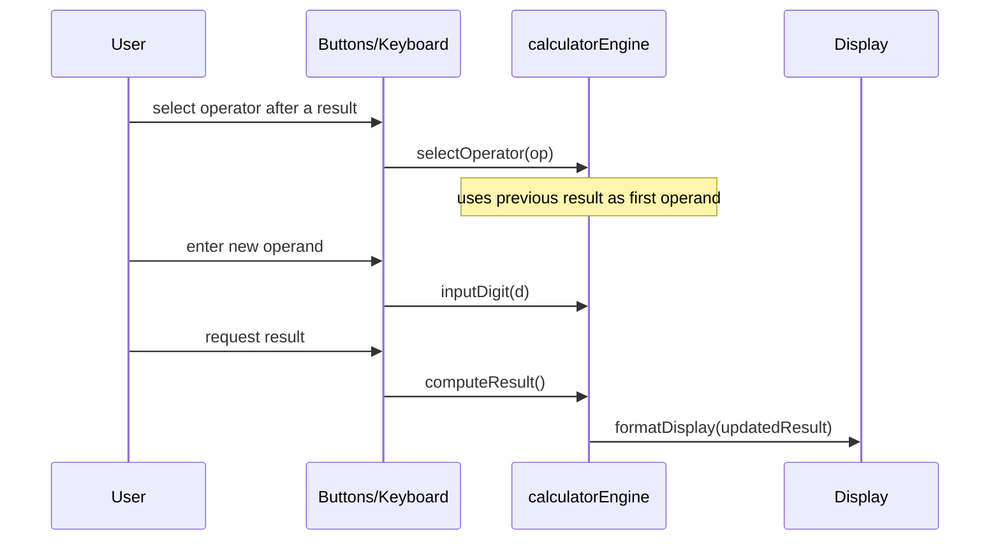
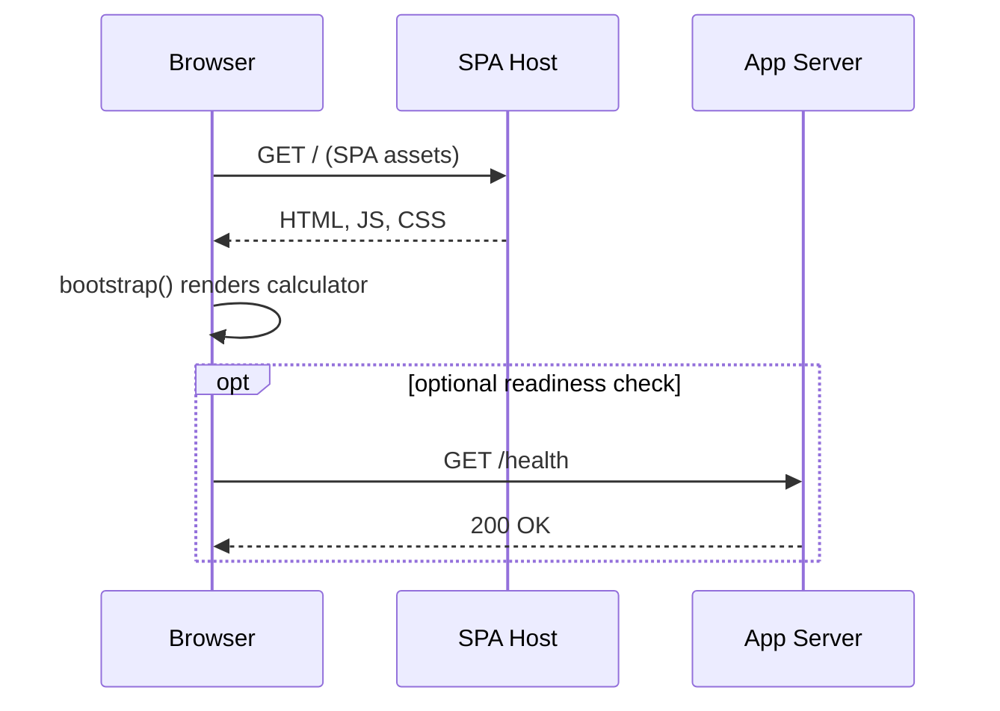
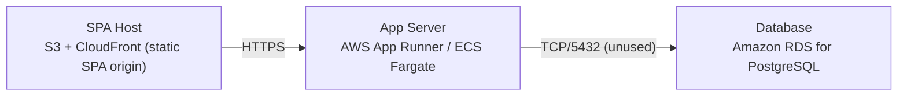

# Architecture

> Maintained by QuorQ AI SDLC. Text between `sdlc:auto` markers is regenerated; anything outside them is yours and is kept.

<!-- sdlc:auto:start narrative -->
## Overview

### ARCH-OVERVIEW · approved · source: architecture:summary

Simple four-function calculator computed entirely client-side in a React 19 SPA, with no data leaving the device and nothing persisted between sessions.

Architecture v1, status approved. All arithmetic (add, subtract, multiply, divide, percentage, chaining, decimals, sign toggle, divide-by-zero handling, clear/reset) runs in-browser. A FastAPI 0.115 backend exists only to serve the app and expose a health endpoint; PostgreSQL 16 is provisioned as the platform default but is unused since the product stores nothing. SPA and API are hosted at separate origins per platform convention. No login, no accounts, no history, no payments, no ads.

**Related:** US-001, US-002, US-003, US-004, US-005, US-006, US-007, US-008, US-009, US-010, US-011, US-012, US-013, US-014

### ARCH-COMP-SPA · approved · source: architecture:component:spa

Calculator Web App built in React 19 renders the UI and performs all calculation logic in the browser.

Renders the calculator UI (buttons and display); captures on-screen and keyboard input; runs all arithmetic in-browser; manages the running-result state machine; handles decimals, sign toggle, percentage, chained operations, and divide-by-zero error; handles clear/reset. Responsive for desktop and mobile. Keeps no state across sessions.

**Related:** US-005, US-006, US-012

### ARCH-COMP-API · approved · source: architecture:component:api

App Server built on FastAPI 0.115 serves the single-page application and exposes a health endpoint only.

No business logic, no auth, no persistence -- all calculation lives in the browser. Present so a server-side feature can be added later without restructuring the system.

### ARCH-COMP-DB · approved · source: architecture:component:db

PostgreSQL 16 is provisioned as the platform-default relational database but is intentionally unused in this product.

The product stores no accounts, no history, and no calculations, so the database carries no tables in this MVP. Available if usage counts or saved results are added later.

**Related:** US-014

### ARCH-PATH-COMPUTE · approved · source: architecture:critical_path:compute

Core flow for entering operands and an operator and requesting a computed result, including divide-by-zero handling.

User enters a first operand, selects an operator, enters a second operand via on-screen buttons or keyboard, and requests the result. The calculator applies the operation and updates the running display. Division by zero yields a clear error instead of a number.

**Related:** US-001, US-002, US-003, US-004, US-007, US-008

### ARCH-PATH-CHAIN · approved · source: architecture:critical_path:chain

Chained-operation flow where a new operator/operand pair applies to the previous running result.

After a result is shown, the user selects a new operator and operand and requests the result, so the new operation applies to the previous result. Pressing a further operator before requesting a result continues the chain using the most recent operator.

**Related:** US-009, US-010

### ARCH-PATH-LOAD · approved · source: architecture:critical_path:load

Initial page-load flow for opening the calculator with no login or data fetch required.

A visitor opens the calculator URL. The SPA is served from its own origin, reads the API base URL from a NEXT_PUBLIC/VITE environment variable (used only for an optional health ping), and renders a fully usable calculator with no login or data fetch.

**Related:** US-013

### ARCH-ENDPOINT-HEALTH · approved · source: architecture:endpoint:GET /health

Single backend endpoint, a liveness/readiness health check.

GET /health -- liveness/readiness probe for the app server. Returns a simple OK status. No business data is exposed.

### ARCH-DEPLOY · approved · source: architecture:deployment_nodes

Three deployment nodes: static SPA hosting, a containerized API, and a managed Postgres instance, all on AWS.

SPA Host: S3 + CloudFront serving the React 19 static build. App Server: AWS App Runner / ECS Fargate running FastAPI 0.115 on Python via Uvicorn. Database: Amazon RDS for PostgreSQL 16 (provisioned but unused).

**Related:** NFR-002

### ARCH-TECH-FRONTEND · approved · source: architecture:technology_decision:frontend

React 19 chosen for the frontend over Vue, Svelte, and Vanilla JS.

Decision: React 19. Alternatives considered: Vue, Svelte, Vanilla JS. Rationale: the entire product is an interactive button-and-display UI with keyboard and touch input and a running-result state machine; React 19's component model and hooks hold calculator state cleanly and render identically on desktop and mobile from one codebase. Cited as serving US-005, US-006, US-012, NFR-002, NFR-003.

**Related:** US-005, US-006, US-012

### ARCH-TECH-BACKEND · approved · source: architecture:technology_decision:backend

FastAPI 0.115 chosen for the backend over static-only hosting, Flask, and Express.

Decision: FastAPI 0.115. Alternatives considered: Static-only hosting with no server, Flask, Express. Rationale: no calculation needs a server, so the backend's only job is to serve the app and offer a health endpoint for the AWS target; FastAPI 0.115 is the approved platform default and leaves room for a server-side feature later without restructuring.

### ARCH-TECH-DB · approved · source: architecture:technology_decision:database

PostgreSQL 16 chosen as the platform-default database over no database or SQLite, despite being unused.

Decision: PostgreSQL 16. Alternatives considered: No database, SQLite. Rationale: the product stores nothing between sessions, so PostgreSQL 16 is provisioned purely as the approved platform default and carries no tables in this MVP; it is available if saved results or usage counts are added later. Cited as serving NFR-001, US-014.

**Related:** US-014

### ARCH-TECH-CLOUD · approved · source: architecture:technology_decision:cloud

AWS chosen as the cloud platform over Vercel/Netlify, Azure, and GCP.

Decision: AWS. Alternatives considered: Vercel/Netlify static hosting, Azure, GCP. Rationale: a free public calculator needs dependable, globally fast hosting for a single-page app; AWS is the approved platform default and serves the SPA via CloudFront and the API via a small container with always-on availability for phone and desktop visitors. Cited as serving NFR-002.
<!-- sdlc:auto:end narrative -->

<!-- sdlc:auto:start building-blocks -->
## Building Block View

| ID | Name | Technology | Responsibility | Depends on |
|---|---|---|---|---|
| spa | Calculator Web App | React 19 | Renders the calculator UI (buttons and display), captures on-screen and keyboard input, runs all arithmetic in-browser, manages the running-result state machine, handles decimals, sign toggle, percentage, chained operations, divide-by-zero error, and clear/reset. Responsive for desktop and mobile. Keeps no state across sessions. | api |
| api | App Server | FastAPI 0.115 | Serves the single-page application to visitors and exposes a health endpoint. No business logic, no auth, no persistence — all calculation lives in the browser. Present so a server-side feature can be added later without restructuring. | — |
| db | PostgreSQL (unused default) | PostgreSQL 16 | Platform-default relational database. Provisioned for the stack but intentionally unused: the product stores no accounts, no history and no calculations. Available if usage counts or saved results are added later. | — |

<!-- sdlc:auto:end building-blocks -->

<!-- sdlc:auto:start runtime -->
## Runtime View

### Enter and compute an arithmetic result

User enters a first operand, selects an operator, enters a second operand via on-screen buttons or keyboard, and requests the result. The calculator applies the operation and updates the running display. Division by zero yields a clear error instead of a number.

- **Components:** spa
- **Modules:** CalculatorApp, calculatorEngine, InputHandler, Display
- **Key functions:** inputDigit(digit), inputDecimal(), selectOperator(op), toggleSign(), applyPercentage(), computeResult(), clearAll(), formatDisplay(value)

### Chained operation using running result

After a result is shown, the user selects a new operator and operand and requests the result, so the new operation applies to the previous result. Pressing a further operator before requesting a result continues the chain with the most recent operator.

- **Components:** spa
- **Modules:** CalculatorApp, calculatorEngine, Display
- **Key functions:** selectOperator(op), computeResult(), getRunningResult(), formatDisplay(value)

### Load the calculator page

A visitor opens the calculator URL. The SPA is served from its own origin, reads the API base URL from NEXT_PUBLIC/VITE env (used only for an optional health ping), and renders a fully usable calculator with no login or data fetch.

- **Components:** spa, api
- **Modules:** index.html, main, CalculatorApp, HealthEndpoint
- **Key functions:** bootstrap(), GET /health

<!-- sdlc:auto:end runtime -->

<!-- sdlc:auto:start deployment-view -->
## Deployment View

| Name | Service | Runtime | Scaling | Environment |
|---|---|---|---|---|
| SPA Host | S3 + CloudFront (static SPA origin) | React 19 build (static assets) | CDN edge caching, scales with visitor traffic automatically | dev |
| App Server | AWS App Runner / ECS Fargate | FastAPI 0.115 on Python (Uvicorn) | 1 small instance, horizontal auto-scale on request count | dev |
| Database | Amazon RDS for PostgreSQL | PostgreSQL 16 | Single smallest instance; idle — provisioned default, no tables | dev |

| Source | Target | Protocol |
|---|---|---|
| SPA Host | App Server | HTTPS |
| App Server | Database | TCP/5432 (unused) |

<!-- sdlc:auto:end deployment-view -->

<!-- sdlc:auto:start decisions -->
## Architecture Decisions

| Layer | Choice | ADR |
|---|---|---|
| Frontend | React 19 | [ADR-0001](adr/frontend.md) |
| Backend | FastAPI 0.115 | [ADR-0002](adr/backend.md) |
| Database | PostgreSQL 16 | [ADR-0003](adr/database.md) |
| Cloud | AWS | [ADR-0004](adr/cloud.md) |
<!-- sdlc:auto:end decisions -->

<!-- sdlc:auto:start links -->
## Related Documents

- [Data Model](data-model.md)
- [API Specification](api/openapi.yaml)
- [Architecture Decision Records](adr/README.md)
<!-- sdlc:auto:end links -->
